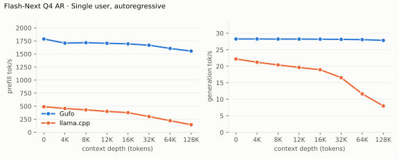

# Qwen3.8 Flash-Next benchmarks

AMD Strix Halo `gfx1151`, 128 GB unified memory. Unsloth `UD-Q4_K_XL` target and
shared-Q8_0 MTP sidecar; Gufo uses adaptive MTP. HTTP, greedy, thinking off.
The complete October 18, 2026 Gufo sweeps use `fec4759d` and the validated
host-memory and cache-stall fixes; the focused October 21 follow-up is separate.
Reference results remain unchanged from September 22–23.
llama.cpp uses `b11069` for AR and `6fcaa16f` for MTP.

Positive gain favors Gufo.
[Quality and measurement details](QUALITY.md#benchmark-method) · [Model identities](artifacts/model-identities.json)

Gufo numerical regression checks pass; individual functional timing limits
remain documented in [QUALITY.md](QUALITY.md). Historical llama.cpp MTP values are retained as requested:
a separate check of that pin did not match its own AR output, so this review
does not requalify those comparisons. [Review evidence](artifacts/decode-kernels-review.json).

At 128K, Gufo reaches 1557.18 tok/s AR prefill and 1481.19 tok/s MTP prefill.
All 24 single-user rows match the previous qualified capture in completion
hashes and prompt/cache counts.
All 63 concurrent tg128 completions match the corresponding C1 AR control.
Repetitive MTP through 64K reports mean ± sample standard deviation across
the sweep and one focused repeat. Initial PP dips at 16K/32K/64K did not
repeat against current main; both observations remain included.
Prior mixed MTP C2 repeats show two draft-controller trajectories (about 54
and 60 tok/s, identical text), so its gain is not entirely attributable to lookup.

## Sampled decode follow-up, October 21

Focused production comparison against main `0c03748a`, candidate `1d3b8c68`,
with the same Nix toolchain, weights and ordered request histories. Model
defaults are used for sampled requests; concurrency is physical, and the C>1
rates sum the individual decode rates. These measurements qualify the decode
changes separately from the complete October 18 tables below. They do not
refresh the reference data.

| Workload | Main tok/s | Candidate tok/s |
| --- | ---: | ---: |
| Copy existing code, default sampling, C1 | 109.59 | 112.30 |
| Generate new code, default sampling, C1 | 75.18 | 75.40 |
| Generate prose, default sampling, C1 | 39.74 | 39.76 |
| Thinking/code, default sampling, C1 | 51.93 | 52.05 |
| Greedy code control, C1 | 70.42 | 70.51 |
| Default-sampled copying, C2 aggregate | 132.93 | 135.45 |

These 128-token screens retain identical outputs and prompt/cache counts;
all 276 matched request/phase measurements pass the 5% and 3 ms gate. The
screens measure speed, not complete coding-task accuracy.

Earlier complete-workflow and mixed-cohort checks against main `da5d5a2b`,
before rebasing onto the merged small-prefill changes, remain separate:

| Workload | Main tok/s | Candidate tok/s |
| --- | ---: | ---: |
| Extraction with thinking, 726 tokens | 82.52 | 82.76 |
| Generate and execute URI tests, 441 tokens | 78.54 | 78.79 |
| File-edit tool call at 32K, thinking off | 76.42 | 77.01 |
| File-edit tool call at 32K, thinking on | 72.40 | 72.47 |
| Mixed greedy/default-sampled copying, C2 | 137.63 | 139.50 |
| Mixed greedy/default-sampled copying, C4 | 200.22 | 202.94 |
| Mixed greedy/default-sampled copying, C6 | 218.78 | 221.54 |
| Mixed greedy/default-sampled copying, C8 | 237.34 | 240.87 |

All outputs in these matched captures agree. The extraction, URI and file-edit
fixtures check their actual results. A real Pi conversation also passes, with ten
successful tool calls and executed assertions; its unseeded run is correctness
evidence, not a matched speed claim.

Canonical greedy pp2048/tg128 spots on current main and candidate use the
original single-user context capacity and cache preparation:

| Mode | Cached depth | Main PP | Candidate PP | Main TG | Candidate TG |
| --- | ---: | ---: | ---: | ---: | ---: |
| AR | 0 | 1793.17 | 1792.97 | 28.87 | 28.88 |
| AR | 32,768 | 1651.93 | 1650.85 | 28.74 | 28.77 |
| MTP mixed | 0 | 1724.11 | 1727.57 | 36.18 | 36.31 |
| MTP mixed | 32,768 | 1607.67 | 1605.39 | 40.56 | 40.51 |
| MTP repetitive | 0 | 1737.22 | 1733.71 | 118.61 | 120.25 |
| MTP repetitive | 32,768 | 1609.07 | 1609.65 | 113.61 | 115.07 |

Concurrent greedy TG: repetitive C2 166.15 → 170.96, repetitive C8
245.05 → 247.09, mixed C8 133.65 → 134.61 tok/s. All measured concurrent
completions match isolated AR controls.

Mixed C2 remains variable: the current pair is 62.17 → 55.30 tok/s and the
focused reverse-order control is 53.30 → 55.29. The pre-rebase pair was
62.17 → 55.36 and its reverse-order repeat was 53.30 → 64.03. Main proposes
93 versus 39 drafts per response across its current runs; the final candidate
proposes 56 in both. Both builds produce identical text. These observations do
**not** establish a C2 speedup or a confirmed slowdown. Individual cache,
queue and preparation timing flags remain visible in the
[quality record](QUALITY.md#exact-sampled-decode-october-21-2026); no blanket
timing pass is claimed.

## Single user, autoregressive

Approximately pp2048 / tg128; depth is the cached prefix in tokens.
Context capacities differ between engines; see the measurement details.

<!-- bench:single-ar -->
| Flash-Next Q4 AR Depth (tokens) | Gufo pp (tok/s) | llama.cpp pp (tok/s) | Gain | Gufo tg (tok/s) | llama.cpp tg (tok/s) | Gain |
| ---: | ---: | ---: | ---: | ---: | ---: | ---: |
| 0 | 1801.01 | 489.59 | +267.9% | 28.29 | 22.20 | +27.4% |
| 4,096 | 1727.95 | 455.24 | +279.6% | 28.27 | 21.21 | +33.3% |
| 8,192 | 1721.41 | 428.85 | +301.4% | 28.27 | 20.40 | +38.6% |
| 12,288 | 1710.64 | 400.21 | +327.4% | 28.21 | 19.64 | +43.6% |
| 16,384 | 1706.86 | 375.89 | +354.1% | 28.25 | 18.95 | +49.1% |
| 32,768 | 1672.60 | 301.31 | +455.1% | 28.18 | 16.54 | +70.4% |
| 65,536 | 1602.93 | 221.94 | +622.2% | 28.09 | 11.62 | +141.7% |
| 131,072 | 1557.18 | 144.78 | +975.5% | 27.85 | 7.98 | +249.0% |
<!-- /bench -->

## Single user, MTP

pp is the highest measured rate per engine and depth across mixed/repetitive
text, including Gufo predictor catch-up.

The two prompt-lookup sections below are fork history: they measure the
fork's own lookup, which upstream's prompt lookup (#613) replaced in the fork's
sync onto main `1f97092`. See
[Prompt lookup on v0.15.0](#prompt-lookup-on-v0150-file-rewrite) and
[Prompt lookup, ROCm container build](#prompt-lookup-rocm-container-build-historical-v0130).

<!-- bench:single-mtp -->
| Flash-Next Q4 MTP Depth (tokens) | Gufo pp (tok/s) | llama.cpp pp (tok/s) | Gain pp | Gufo tg mixed (tok/s) | llama.cpp tg mixed (tok/s) | Gain mixed | Gufo tg repetitive (tok/s) | llama.cpp tg repetitive (tok/s) | Gain repetitive |
| ---: | ---: | ---: | ---: | ---: | ---: | ---: | ---: | ---: | ---: |
| 0 | 1734.96 ± 0.85 | 468.76 | +270.1% | 35.79 | 31.73 | +12.8% | 116.93 ± 0.10 | 48.12 | +143.0% |
| 4,096 | 1676.83 ± 1.73 | 423.79 | +295.7% | 37.64 | 34.48 | +9.2% | 116.41 ± 0.07 | 45.71 | +154.7% |
| 8,192 | 1669.91 | 394.98 | +322.8% | 36.91 | 32.20 | +14.6% | 114.08 ± 0.01 | 44.31 | +157.5% |
| 12,288 | 1660.54 ± 1.22 | 365.91 | +353.8% | 39.28 | 32.32 | +21.5% | 105.48 ± 0.15 | 43.53 | +142.3% |
| 16,384 | 1635.18 | 341.98 | +378.2% | 40.54 | 32.07 | +26.4% | 113.32 ± 0.23 | 43.66 | +159.6% |
| 32,768 | 1618.63 | 277.61 | +483.1% | 39.97 | 25.41 | +57.3% | 105.38 ± 0.17 | 39.28 | +168.3% |
| 65,536 | 1556.32 | 208.04 | +648.1% | 39.23 | 19.65 | +99.6% | 104.78 ± 0.21 | 27.75 | +277.6% |
| 131,072 | 1481.19 | 135.42 | +993.8% | 39.87 | 14.63 | +172.5% | 108.37 | 20.96 | +417.0% |
<!-- /bench -->

## Multiple users, autoregressive

Same pp2048 prose prompt as single-user d0, tg128, context 4096 per user.
All sessions prefilled before timed decoding; throughput sums individual rates.
llama.cpp re-evaluates its four-token checkpoint tail.

<!-- bench:multi-ar -->
| Flash-Next Q4 AR Users | Gufo AR (tok/s) | llama.cpp AR (tok/s) | Gain |
| ---: | ---: | ---: | ---: |
| 1 | 28.24 | 22.34 | +26.4% |
| 2 | 50.66 | 37.08 | +36.6% |
| 4 | 86.01 | 54.82 | +56.9% |
| 6 | 108.34 | 65.34 | +65.8% |
| 8 | 125.48 | 68.79 | +82.4% |
<!-- /bench -->

## Multiple users, MTP

Same pp2048 mixed/repetitive prompts as single-user d0, tg128, context 4096
per user. All sessions prefilled before timed decoding; rates sum individual
request decode rates. C1 cross-checks the single-user table.

<!-- bench:multi-mtp -->
| Flash-Next Q4 MTP Users | Gufo mixed (tok/s) | llama.cpp mixed (tok/s) | Gain | Gufo repetitive (tok/s) | llama.cpp repetitive (tok/s) | Gain |
| ---: | ---: | ---: | ---: | ---: | ---: | ---: |
| 1 | 35.74 | 31.77 | +12.5% | 116.50 | 46.93 | +148.2% |
| 2 | 61.30 | 42.79 | +43.3% | 165.50 | 52.57 | +214.8% |
| 4 | 88.77 | 48.78 | +82.0% | 218.12 | 48.23 | +352.2% |
| 6 | 109.74 | 52.59 | +108.7% | 231.85 | 48.51 | +377.9% |
| 8 | 127.02 | 61.92 | +105.1% | 245.81 | 58.13 | +322.9% |
<!-- /bench -->

## Prompt lookup on v0.15.0, file rewrite

Historical: the fork's own lookup, replaced by upstream #613 in the sync onto
main `1f97092`.

October 14, 2026, pinned Nix production builds (flake.lock `faabad82`):
stock v0.15.0 `89d6185` (`8bd1567a`) against candidate `2c4039e`
(`2b2960c1`).
- **Workload:** the greedy `rewrite` request of the historical runs below. A
  230-line Python file with one function rename, returned complete, 1,949
  generated tokens.
- **Method:** `--sessions 1 --context 65536 --think off`, MTP. Each sample is
  a fresh process, with one identical warm-up request and no disk cache. The
  times cover the complete rewrite request, including 1,994 uncached prefill
  tokens (about 1.3 s on both builds).
- **Correctness:** the output is byte-identical between builds and exactly
  the expected edit.

| Pair | Order | Stock wall / decode (s) | Candidate wall / decode (s) | Wall change | Decode rate |
| ---: | --- | ---: | ---: | ---: | ---: |
| 1 | AB | 29.01 / 27.69 | 21.82 / 20.50 | −24.8% | 1.35× |
| 2 | BA | 29.34 / 28.03 | 21.36 / 20.05 | −27.2% | 1.40× |
| 3 | BA | 28.70 / 27.39 | 21.35 / 20.03 | −25.6% | 1.37× |
| 4¹ | AB | 28.64 / 27.32 | 22.86 / 20.58 | −20.2% | 1.33× |

Paired median: −25.2% wall time, 1.36× decode rate. Per request, stock
proposes 1,772 MTP drafts and accepts 1,639 in 310 rounds. The candidate
proposes 1,710 and accepts 1,704 in 245 rounds; 1,142 of those accepted are
prompt-lookup copies. This is a focused 4-pair experiment on one fixture,
not general coding performance or a full qualification; cold-start timing
remains inconclusive ([QUALITY](QUALITY.md)).

¹ The candidate process hit the host drive's slow read state, which added
about 1 s of prefill. The pair is reported but not interpretable; pairs 1–3
are clean.

[Evidence](artifacts/prompt-lookup-v015.json).

## Prompt lookup, ROCm container build (historical, v0.13.0)

Not comparable with the Nix tables above or with the v0.15.0 rewrite: matched
ROCm 10 container builds, GCC host compiler, October 12, 2026.
- **Base:** v0.13.0 `fcf8bf7`, binary `d781bceb`.
- **Candidate:** `a0aee02`, binary `14a7cc1f`.

Same workloads, `tools/bench/model-bench.py`. Each cell is two passes in
alternating order (pass 1 / pass 2). Greedy outputs are byte-identical
between builds, and every multi-user completion matches the same-toolchain
AR reference. Pinned Nix results for the candidate follow below.

Single user, MTP, pp2048/tg128. The gain is from pass 2.

| Depth (tokens) | Text | Base pp (tok/s) | Candidate pp (tok/s) | Base tg (tok/s) | Candidate tg (tok/s) | Gain tg |
| ---: | --- | ---: | ---: | ---: | ---: | ---: |
| 0 | mixed | 1,552.10 / 1,570.17 | 1,573.79 / 1,565.18 | 30.54 / 30.51 | 30.57 / 30.53 | +0.1% |
| 0 | repetitive | 884.34¹ / 1,566.59 | 1,561.11 / 1,567.07 | 59.21¹ / 64.55 | 100.25 / 100.11 | +55.1% |
| 32,768 | mixed | 1,437.77 / 1,430.71 | 1,438.90 / 1,441.10 | 33.16¹ / 38.67 | 38.63 / 38.39 | −0.7% |
| 32,768 | repetitive | 971.67¹ / 1,450.06 | 1,381.75 / 1,446.12 | 41.49¹ / 44.49 | 98.13 / 98.01 | +120.3% |

¹ This base pass ran in a slow machine state:
- Its first 2K prefill took 3,065 ms against 2,038 ms, and lookup does not
  run during prefill.
- Its 32K mixed run had identical drafts.

Multiple users, MTP, tg128, context 4096 per user. Gains are per pass.

| Users | Base mixed (tok/s) | Candidate mixed (tok/s) | Gain | Base repetitive (tok/s) | Candidate repetitive (tok/s) | Gain |
| ---: | ---: | ---: | ---: | ---: | ---: | ---: |
| 1 | 27.83 / 30.44 | 30.43 / 30.40 | +9.3% / −0.1% | 60.75 / 63.60 | 98.98 / 101.22 | +62.9% / +59.2% |
| 2 | 52.90 / 50.77 | 50.67 / 45.11 | −4.2% / −11.1% | 78.79 / 81.95 | 140.76 / 144.46 | +78.7% / +76.3% |
| 4 | 75.92 / 70.36 | 84.13 / 69.68 | +10.8% / −1.0% | 136.94 / 126.80 | 183.37 / 200.18 | +33.9% / +57.9% |
| 6 | 97.00 / 97.17 | 97.11 / 97.28 | +0.1% / +0.1% | 132.58 / 148.81 | 199.90 / 215.00 | +50.8% / +44.5% |
| 8 | 111.67 / 112.34 | 111.16 / 111.43 | −0.5% / −0.8% | 177.16 / 163.64 | 219.29 / 231.05 | +23.8% / +41.2% |

Mixed C2 and C4 swings are machine state, not lookup:
- Traces show no copies in either workload.
- Three alternating untraced C2 pairs: base 53.03 / 51.07 / 44.41, candidate
  51.07 / 51.05 / 47.79 tok/s.
- At identical drafts the builds matched (51.05 vs 51.07).
- Slow runs on either build have every cycle about 12% slower.

Pinned Nix production builds (candidate `5ba35a3b`, base `c4c55240`;
disposable container, not the build behind the Nix tables above) were checked
over HTTP. Order was base, candidate, candidate, base, with greedy output
byte-identical. Nix tables still need refreshing.

| Workload | Greedy, shallow / 32K | Sampled, shallow / 32K |
| --- | ---: | ---: |
| Rewrite | +40.1% / +48.3% | +49.0% / +50.5% |
| Small edit | +28.7% / +39.3% | +28.8% / +24.7% |
| Mixed prose | 0.0% / +0.1% | 0.0% / −0.1% |
| Fresh code | +0.7% / +0.4% | +2.4% / −2.0% |

Batch-cost accounting fix (`3c7922f`, container binary `3647d37e`) versus
`a0aee02`, three alternating pairs (mean tok/s):

| Case | `a0aee02` | Fix | Change |
| --- | ---: | ---: | ---: |
| Repetitive C2 | 151.16 | 149.06 | −1.4%¹ |
| Repetitive C4 | 192.62 | 200.28 | +4.0%¹ |
| Mixed C2 | 49.24 | 48.92 | −0.7% |
| Mixed C4 | 78.11 | 80.56 | +3.1% |

¹ Repetitive draft counts are identical in every run, and the samples agree
within 0.2% apart from one slow sample per build. Mixed draft counts vary
by run on both builds. Single-user rewrite and prose are within 0.2%.

Final source `dcd7a8c` (timed Nix binary `221ef3b5` of `0821c8a`, base
`c4c55240`):

| Workload | Greedy, shallow / 32K | Sampled, shallow / 32K |
| --- | ---: | ---: |
| Rewrite | +40.3% / +51.3% | +48.9% / +48.0% |
| Small edit | +28.0% / +34.2% | +28.3% / +33.5% |
| Prose | −0.0% / +0.9% | −0.1% / −1.1% |

The quoted-argument tool calls match the baseline again. Concurrency rows
above predate the anchor fix, which does not change batched copying of
repetitive text (no anchor copies there).

Token gaps come from the HTTP A/B runs, not this driver:
- **ABBA runs:** the largest gap was 166 ms on the candidate and 158 ms on
  base (both 32K prose). On rewrites and small edits it was 111 ms against
  126 ms.
- **Cold 2-session run** (262K context, disk cache): 194 ms on the
  candidate, against 197 ms on base and 283 ms on an unchanged-base control.

These gains are relative to v0.13.0 and were not remeasured on main
`2599ad6`. The rebase leaves the lookup sources unchanged. Main's only
decode-path change is allocation placement, which kept the same device
footprint on this host; see [QUALITY](QUALITY.md).

[Evidence](artifacts/decode-prompt-lookup.json) (`final_v013`).

## Loading time

C1, context capacity 262144, MTP. Cold target/sidecar files to HTTP readiness.

<!-- bench:loading -->
| Flash-Next Q4 Target | Gufo ready (s) | llama.cpp ready (s) | Gain |
| --- | ---: | ---: | ---: |
| Q4 | 16.42 | 117.83 | +617.6% |
<!-- /bench -->

## Memory occupation

C1, context capacity 133121, AR. Peak memory reported by HIP.

<!-- bench:memory -->
| Flash-Next Q4 AR Workload | Gufo GiB | llama.cpp GiB | Gain |
| --- | ---: | ---: | ---: |
| pp2048 + tg128 | 88.78 | 84.84 | -4.4% |
| 16K prefix, pp4096 + tg128 | 90.53 | 85.31 | -5.8% |
<!-- /bench -->

